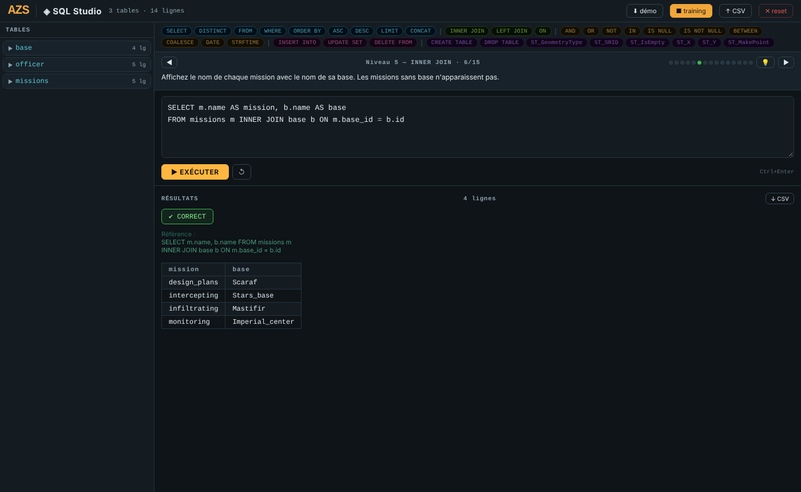

<!--
  Nom      : LISEZMOI.md
  Objet    : Présentation de SQL Studio (dépôt GitHub)
  Auteur   : Eric PERRET
  Date     : 2026-10-27
  Version  : 2.3
-->

# SQL Studio

🇬🇧 [English version: README.md](README.md)

▶️ **[Lancer SQL Studio](https://ericperret.github.io/sql_studio/sql_studio.html)** — prêt à l'emploi, base de démonstration incluse.

**Un interpréteur SQL complet qui tourne dans votre navigateur — zéro serveur, zéro dépendance, un seul fichier HTML.**

Interface en français. Documentation détaillée : [sql_studio_doc.odt](sql_studio_doc.odt) (LibreOffice Writer).

---

## Origine

La base de données embarquée est une mini base de support pédagogique librement copiée depuis l'image d'un quiz DGSE. Trois tables, des jointures naturelles, des NULLs intentionnels — tout ce qu'il faut pour apprendre SQL sans friction.

---

## Ce que c'est

Un outil pédagogique pour apprendre et pratiquer SQL, entièrement autonome. Pas de Node.js. Pas de Python. Pas de CDN. Pas de framework. Ouvrez le fichier dans Firefox ou Chrome — c'est prêt.

---

## Fonctions

| Fonction | Description |
|---|---|
| Moteur SQL | Interpréteur SQL en JavaScript pur, données en mémoire |
| Explorateur de tables | Colonnes, types et aperçu des données ; boutons SELECT * et DROP par table |
| Palette de mots-clés | Insertion d'un clic des mots-clés et fonctions, classés par famille |
| Éditeur | Exécution par bouton ou Ctrl+Entrée |
| Mode Training | 15 exercices sur 10 niveaux, indices et solutions progressifs, cours par niveau |
| Import / export | Import d'un CSV comme table, export CSV du dernier résultat |
| Sauvegarde | Base et progression conservées dans le `localStorage` du navigateur |

---

## Le moteur SQL

C'est la pièce maîtresse. Un interpréteur SQL écrit en JavaScript pur capable d'exécuter de vraies requêtes sur de vraies données en mémoire.

**Requêtes supportées :**

- `SELECT` avec colonnes nommées, alias `AS`, `*`
- `SELECT DISTINCT`
- `FROM` avec alias de table
- `INNER JOIN` et `LEFT JOIN` (avec `ON` et gestion des NULLs)
- Jointures multiples (3 tables ou plus)
- `WHERE` avec `AND`, `OR`, `NOT`, `IN`, `NOT IN`, `BETWEEN`, `IS NULL`, `IS NOT NULL`, opérateurs `=` `!=` `>` `<` `>=` `<=`
- `CASE WHEN ... THEN ... ELSE ... END` avec calcul arithmétique (`+`)
- `ORDER BY` multi-colonnes `ASC` / `DESC`
- `LIMIT`

**Fonctions :**

- `COALESCE`, `CONCAT`
- `DATE`, `STRFTIME`
- Spatiales : `ST_MakePoint(lon, lat)`, `ST_X`, `ST_Y`, `ST_SRID`, `ST_GeometryType`, `ST_IsEmpty`

**DDL/DML supportés :**

- `CREATE TABLE`
- `DROP TABLE`
- `INSERT INTO ... VALUES`
- `UPDATE ... SET ... WHERE`
- `DELETE FROM ... WHERE`

**Ce que le moteur fait bien :**

Les NULLs sont traités correctement. Un `LEFT JOIN` sur une clé étrangère NULL conserve la ligne avec des colonnes droites à NULL — exactement comme un vrai SGBD. Le scoring `CASE WHEN` additionne proprement plusieurs expressions. Les alias de tables sont résolus dans les conditions `ON` et `WHERE` sans ambiguïté.

---

## Le mode Training

15 exercices progressifs sur 10 niveaux :

| Niveau | Thème | Questions |
|--------|-------|-----------|
| 1 | SELECT | 1 |
| 2 | WHERE | 1 |
| 3 | AND / OR / IS NULL | 1 |
| 4 | DISTINCT · ORDER BY | 2 |
| 5 | INNER JOIN | 2 |
| 6 | LEFT JOIN | 2 |
| 7 | 3 tables | 2 |
| 8 | CASE WHEN | 2 |
| 9 | INSERT | 1 |
| 10 | CREATE TABLE | 1 |

**La validation porte sur le résultat, pas sur la syntaxe.** Deux requêtes différentes qui produisent le même output sont toutes les deux acceptées.

Niveaux 4 à 8 : après 5 erreurs → indice. Après 10 erreurs → solution + question reformulée différemment.

La progression est sauvegardée en `localStorage` — elle survit au rechargement.

Chaque niveau dispose d'une bulle de cours académique (bouton 💡) avec exemples.

---

## Import / Export

- **⬇ démo** : charge la base DGSE (3 tables)
- **↑ CSV** : importe n'importe quel fichier `.csv` comme nouvelle table, types auto-détectés
- **↓ CSV** : exporte le résultat de la dernière requête SELECT
- **✕ reset** : efface tout

---

## Utilisation

Ouvrir le lien ci-dessus, ou télécharger `sql_studio.html` et l'ouvrir dans un navigateur.

Aucune installation. Aucun serveur. Fonctionne hors ligne.

---

## Historique

| Version | Évolution |
|---|---|
| 2.1 | Version publiée : moteur SQL, mode Training, import / export CSV |
| 2.2 | Copie ancienne collée en fin de fichier supprimée (interface et script en double) |
| 2.3 | Charte graphique AZS (palette ardoise / ambre / cyan, marque AZS avec lien de retour vers www.azs.fr, polices système) ; disposition empilée sur petit écran |

---

## Licence

**Usage libre non commercial** — [CC BY-NC 4.0](https://creativecommons.org/licenses/by-nc/4.0/deed.fr), avec mention obligatoire de la source et de l'auteur :

> sql_studio — Eric PERRET — https://github.com/ericperret/sql_studio

Toute utilisation commerciale est interdite sans autorisation écrite de l'auteur, à demander par courriel : **eperret@azs.fr**.
Conditions complètes (français / anglais) : [LICENSE](LICENSE).
